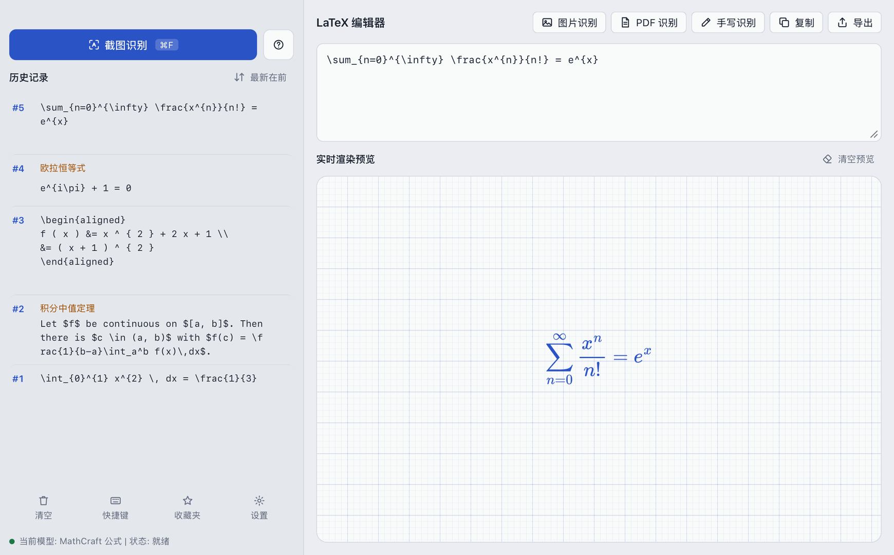

<div align="center">

# LaTeXSnipper Lite

**把截图、图片、PDF 和手写变成可编辑的 LaTeX**

[下载](https://github.com/sigmalos/LaTeXSnipper-lite/releases/latest) · [原版 LaTeXSnipper](https://github.com/SakuraMathcraft/LaTeXSnipper) · [模型仓库](https://github.com/SakuraMathcraft/MathCraft-Models)



</div>

本项目是 [SakuraMathcraft/LaTeXSnipper](https://github.com/SakuraMathcraft/LaTeXSnipper) 的轻量版。识别效果和界面布局沿用原版，使用 Rust 和 Tauri，macOS 安装包约 **12 MB**。

## 下载与安装

### macOS

**系统要求**：macOS 13 或更新版本，Apple Silicon（M 系列芯片）。

1. 从 [Releases](https://github.com/sigmalos/LaTeXSnipper-lite/releases/latest) 下载 `LaTeXSnipper_1.0.0_aarch64.dmg`。
2. 打开 DMG，把 **LaTeXSnipper** 拖进「应用程序」。
3. 安装包没有经过 Apple 公证，首次打开时 macOS 会提示「Apple 无法验证“LaTeXSnipper”是否包含恶意软件」。点「完成」，然后打开「系统设置 → 隐私与安全性」，在页面底部点「仍要打开」。也可以在终端执行：

   ```sh
   xattr -dr com.apple.quarantine /Applications/LaTeXSnipper.app
   ```

4. 第一次截图时，按提示在「系统设置 → 隐私与安全性 → 屏幕录制」中允许 LaTeXSnipper。

### Windows

使用 Windows x64 的 `.exe` 安装包。安装程序会在需要时下载 Microsoft Edge WebView2 Runtime。用 **Win+Shift+S** 截图，再回到 Lite 按 **Ctrl+V** 识别，也可以导入或拖入图片。

> [!NOTE]
第一次识别时应用会提示下载所需模型（只用公式识别约 104 MB）。在 macOS 上，Lite 可以使用原版已下载的模型。

## 快速上手

1. 导入或粘贴公式图片。macOS 上也可以按 **⌘F**（或点「截图识别」）框选公式。
2. 在弹出的确认窗口里检查、修改识别结果，点「确认并复制」。结果会复制到剪贴板，并记入左侧历史。
3. 可以使用「PDF 识别」处理文档，或使用「手写识别」输入公式。

关闭窗口后应用会留在后台。通过菜单栏或系统托盘图标重新打开主窗口，或从菜单中退出。

## 功能

| | |
|---|---|
| **识别来源** | 屏幕截图、图片文件、拖放、剪贴板粘贴、PDF（可选页码和分辨率）、手写画布 |
| **识别类型** | 公式 · 混合（文字 + 公式，输出 Markdown）· 纯文字 |
| **识别引擎** | 内置 MathCraft，离线运行；也可接入任何 OpenAI 兼容接口（OpenAI、Ollama、LM Studio、vLLM 等） |
| **编辑预览** | LaTeX 源码编辑，MathJax 实时渲染 |
| **复制导出** | 复制为 LaTeX、`$…$`、`$$…$$`、`\[…\]`、equation、MathML；导出 TeX、Markdown、HTML、MathML、SVG、TXT，macOS 安装 Pandoc 后还可导出 Word、ODT |
| **历史收藏** | 重命名、收藏、排序、删除，macOS 上与原版共用数据目录 |
| **界面** | 中文 / English，浅色 / 深色 / 跟随系统（在设置中点击即可预览），macOS 上可自定义全局截图快捷键 |

## 识别模型

内置 MathCraft 由四个模型组成，从 [MathCraft-Models](https://github.com/SakuraMathcraft/MathCraft-Models/releases) 下载，每个文件都会校验 SHA-256：

| 模型 | 用于 | 下载大小 |
|---|---|---|
| 公式检测 | 混合 | 64 MB |
| 公式识别 | 公式、混合 | 104 MB |
| 文字检测 | 混合、纯文字 | 4.3 MB |
| 文字识别 | 混合、纯文字 | 13 MB |

在「设置 → 识别后端 → 内置 MathCraft」中可以查看每个模型的状态，并单独下载、重新下载或删除。改动立即生效，不需要重启。

## 常见问题

**⌘F 和其他应用的「查找」冲突了？**
⌘F 是全局快捷键，LaTeXSnipper 运行时会占用它。点左下角「快捷键」，按下新的组合键（例如 ⌃⇧F）后保存即可。

**截图识别没有反应？**
多半是没有屏幕录制权限。在「系统设置 → 隐私与安全性 → 屏幕录制」中打开 LaTeXSnipper，然后退出并重新打开应用。

**和原版 LaTeXSnipper 能同时用吗？**
Windows 上，Lite 可以单独安装，数据保存在 `%LOCALAPPDATA%\LaTeXSnipper Lite`。macOS 上，两者都叫 `LaTeXSnipper.app`，拖进「应用程序」会替换原版。两者共用 `~/Library/Application Support/LaTeXSnipper` 下的历史、收藏和模型。

**怎么完全退出？**
在菜单栏或系统托盘中选择「退出 LaTeXSnipper」。macOS 上也可以按 ⌘Q。

## 与原版的区别

| | 原版 LaTeXSnipper | LaTeXSnipper Lite |
|---|---|---|
| 平台 | Windows / Linux / macOS | macOS（Apple Silicon）和 Windows（x64） |
| 技术栈 | Python + PyQt6 + Qt WebEngine | Rust + Tauri 2 + 系统 WebView |
| 安装包 | 552 MB，内置 Python、Qt、Chromium 和模型 | 模型按需下载 |
| 识别引擎 | Python + ONNX Runtime + OpenCV + RapidOCR | 用 Rust 重写，输出与原版逐字一致 |

Lite 尚未移植 Linux 版本、Office 插件、自动化 HTTP API、应用内更新和 MinerU 文档解析。

## 参与开发

需要 Rust（版本由 `rust-toolchain.toml` 固定）和 Node.js 20 或更新版本。

```sh
npm install
npm run tauri dev     # 开发模式运行
npm run dmg           # 构建 DMG，输出到 backend/target/release/bundle/dmg/
```

在 Windows x64 上安装 Visual Studio C++ 生成工具和 Windows SDK 后，运行 `npm run tauri -- build --bundles nsis`。安装包输出到 `backend/target/release/bundle/nsis/`。

<details>
<summary><b>测试</b></summary>

```sh
npm run test:rust     # 后端单元测试 + 真实模型对拍
npm test              # 前端单元测试（Vitest）
npm run test:e2e      # 界面端到端测试（Playwright，无头 WebKit）
npm run test:dmg      # 安装包冒烟测试（需先构建 DMG）
```

- 真实模型对拍用 `backend/tests/fixtures/` 中的图片，结果必须与原版 Python 实现的输出（`python_reference.json`）完全一致。没有模型时这些测试会自动跳过，可以用 `LATEXSNIPPER_MODELS=<模型目录>` 指定模型位置。
- Tauri 的 WebDriver 不支持 macOS，因此界面测试在同引擎的 WebKit 中运行，后端由 `e2e/tauri-mock.js` 模拟；真实后端由 Rust 集成测试和安装包冒烟测试覆盖。
- 所有测试都不会打扰正在使用的电脑：界面测试使用无头浏览器；冒烟测试以 `LATEXSNIPPER_HEADLESS=1` 启动应用，不显示窗口、Dock 图标和菜单栏图标，也不注册快捷键，自检完成后自动退出。

</details>

<details>
<summary><b>目录结构</b></summary>

```
frontend/             前端（TypeScript，无框架）
  main.ts             界面逻辑
  lib/                格式转换、多语言、MathJax 渲染、手写、PDF、后端接口
backend/              后端（Rust + Tauri）
  src/ocr/            MathCraft 识别引擎：模型推理、分词器、版面分析、LaTeX 后处理
  src/commands.rs     前端可调用的命令
  src/shell.rs        菜单栏图标、后台运行、全局快捷键
  src/store.rs        设置、历史与收藏（兼容原版格式）
  src/modelhub.rs     模型下载、校验与删除
  src/external.rs     OpenAI 兼容接口
tests/unit/           前端单元测试
e2e/                  界面端到端测试
scripts/              安装包冒烟测试
```

</details>

## 致谢与许可

- 原项目：[SakuraMathcraft/LaTeXSnipper](https://github.com/SakuraMathcraft/LaTeXSnipper)，本项目的界面设计、识别流程和数据格式均来自原版
- 识别模型：[SakuraMathcraft/MathCraft-Models](https://github.com/SakuraMathcraft/MathCraft-Models)
- 公式渲染：[MathJax](https://www.mathjax.org/)；PDF 渲染：[pdf.js](https://mozilla.github.io/pdf.js/)

与原版一致，本项目以 [GPL-3.0](LICENSE) 协议发布。
