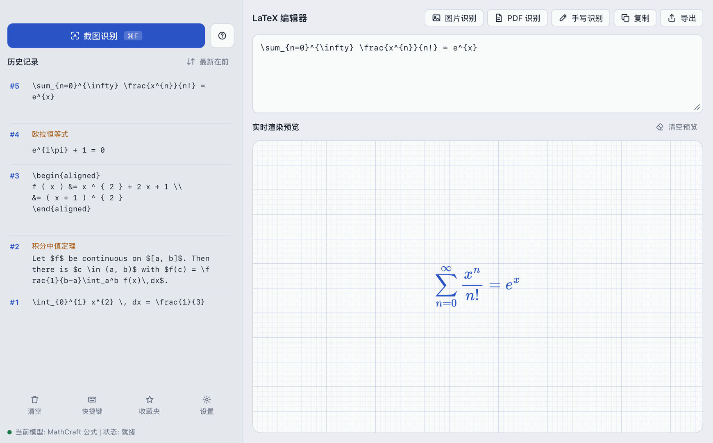

<div align="center">

# LaTeXSnipper Lite

**把截图、图片、PDF 和手写变成可编辑的 LaTeX**

[下载](https://github.com/sigmalos/LaTeXSnipper-lite/releases/latest) · [原版 LaTeXSnipper](https://github.com/SakuraMathcraft/LaTeXSnipper) · [模型仓库](https://github.com/SakuraMathcraft/MathCraft-Models)



</div>

本项目是 [SakuraMathcraft/LaTeXSnipper](https://github.com/SakuraMathcraft/LaTeXSnipper) 的轻量版。识别效果和界面布局沿用原版，使用 Rust 和 Tauri，macOS 安装包约 **12 MB**。支持 macOS（Apple Silicon）、Windows（x64）和 Linux（x86_64）。

> [!IMPORTANT]
> **当前版本的 Windows 和 Linux 版无法进行截图识别**，「截图识别」按钮和全局快捷键只在 macOS 上提供。Windows 和 Linux 版可以识别图片文件、拖入或粘贴的截图、PDF 和手写。

## 下载与安装

### macOS

**系统要求**：macOS 13 或更新版本，Apple Silicon（M 系列芯片）。

1. 从 [Releases](https://github.com/sigmalos/LaTeXSnipper-lite/releases/latest) 下载 `LaTeXSnipper-Lite_<版本>_macos-arm64.dmg`。
2. 打开 DMG，把 **LaTeXSnipper** 拖进「应用程序」。
3. 安装包没有经过 Apple 公证，首次打开时 macOS 会提示「Apple 无法验证“LaTeXSnipper”是否包含恶意软件」。点「完成」，然后打开「系统设置 → 隐私与安全性」，在页面底部点「仍要打开」。也可以在终端执行：

   ```sh
   xattr -dr com.apple.quarantine /Applications/LaTeXSnipper.app
   ```

4. 第一次截图时，按提示在「系统设置 → 隐私与安全性 → 屏幕录制」中允许 LaTeXSnipper。

### Windows

**系统要求**：Windows 10 / 11，x64。

1. 从 [Releases](https://github.com/sigmalos/LaTeXSnipper-lite/releases/latest) 下载 `LaTeXSnipper-Lite_<版本>_windows-x64-setup.exe` 并运行，安装不需要管理员权限。
2. 安装包没有代码签名，SmartScreen 提示「Windows 已保护你的电脑」时，点「更多信息 → 仍要运行」。
3. 应用使用系统的 Microsoft Edge WebView2 Runtime。Windows 10 / 11 一般已自带；如果缺失，安装程序会自动下载。

Windows 版没有截图识别。可以先用系统自带的 **Win+Shift+S** 截图，再回到 Lite 按 **Ctrl+V** 粘贴识别，也可以导入或拖入图片文件。

### Linux

**系统要求**：x86_64，Debian / Ubuntu 等使用 `.deb` 的发行版。

```sh
sudo apt install ./latexsnipper-lite_<版本>_amd64.deb
```

Debian 包依赖 `libwebkit2gtk-4.1-0`、`libgtk-3-0`、`libayatana-appindicator3-1`，安装时由 apt 自动补齐。数据保存在 `~/.local/share/latexsnipper-lite`（遵循 `XDG_DATA_HOME`）。Linux 版同样没有截图识别，可以粘贴、拖入或导入图片。

> [!NOTE]
> 第一次识别时应用会提示下载所需模型（只用公式识别约 104 MB）。在 macOS 上，Lite 可以使用原版已下载的模型。

## 快速上手

第一次打开时，应用会用聚光灯引导逐个介绍界面上的按钮；之后随时可以点左上角的 **?** 再看一遍。

1. 在 macOS 上按 **⌘F**（或点「截图识别」），框选屏幕上的公式；在 Windows 和 Linux 上，粘贴截图或拖入、导入图片。
2. 在弹出的确认窗口里检查、修改识别结果，点「确认并复制」。结果会复制到剪贴板，并记入左侧历史。
3. 可以使用「PDF 识别」处理文档，或使用「手写识别」输入公式。

关闭窗口后应用会留在后台。通过菜单栏或系统托盘图标重新打开主窗口，或从菜单中退出。

## 功能

| | |
|---|---|
| **识别来源** | 屏幕截图（仅 macOS）、图片文件、拖放、剪贴板粘贴、PDF（可选页码和分辨率）、手写画布 |
| **识别类型** | 公式 · 混合（文字 + 公式，输出 Markdown）· 纯文字 |
| **识别引擎** | 内置 MathCraft，离线运行；也可接入任何 OpenAI 兼容接口（OpenAI、Ollama、LM Studio、vLLM 等） |
| **编辑预览** | LaTeX 源码编辑，MathJax 实时渲染 |
| **复制导出** | 复制为 LaTeX、`$…$`、`$$…$$`、`\[…\]`、equation、MathML；导出 TeX、Markdown、HTML、MathML、SVG、TXT，macOS 安装 Pandoc 后还可导出 Word、ODT |
| **Office 插件** | Word / PowerPoint for Mac，单独安装，不需要桌面端：插入和编辑公式、Word 原生公式与编号、截图识别，见 [Office 插件](#office-插件macos) |
| **历史收藏** | 重命名、收藏、排序、删除，macOS 上与原版共用数据目录 |
| **界面** | 中文 / English，浅色 / 深色 / 跟随系统（在设置中点击即可预览），macOS 上可自定义全局截图快捷键 |

## Office 插件（macOS）

在 Word 和 PowerPoint for Mac 中插入、编辑可以再次修改的 LaTeX 公式。插件是单独的应用 **LaTeXSnipper Office**，有自己的 DMG（`LaTeXSnipper-Office_<版本>_macos-arm64.dmg`），和桌面端分开构建、分开安装。装好后它随登录在后台运行，**不打开、甚至不安装 LaTeXSnipper 桌面端也能完整使用**，截图识别也由插件自己完成。

1. 打开 DMG，把 **LaTeXSnipper Office** 拖进「应用程序」，从那里打开它。
2. 先打开一次 Word 和（或）PowerPoint，回到 LaTeXSnipper Office 点「安装」。macOS 会要求输入密码，用来信任一张只对 `localhost` 有效的证书。
3. 需要截图识别时，点「截图识别模型」一行的「下载」（约 109 MB）。已经用 LaTeXSnipper 下载过公式模型的话，插件会直接使用，不必再下载。
4. 重新打开 Word 或 PowerPoint，在「开始 › 加载项」中选择 LaTeXSnipper。

插件的页面和功能沿用原版 LaTeXSnipper 的 Mac 插件，Word 公式与原版 Windows 插件使用同一种文档格式，可以互相打开、编辑和重编号。原版插件能否复用、哪些部分重新构建，以及构建、测试方法，见 [office_plugin/README.md](office_plugin/README.md)。

## 识别模型

内置 MathCraft 由四个模型组成，从 [MathCraft-Models](https://github.com/SakuraMathcraft/MathCraft-Models/releases) 下载，每个文件都会校验 SHA-256：

| 模型 | 用于 | 下载大小 |
|---|---|---|
| 公式检测 | 混合 | 64 MB |
| 公式识别 | 公式、混合 | 104 MB |
| 文字检测 | 混合、纯文字 | 4.3 MB |
| 文字识别 | 混合、纯文字 | 13 MB |

在「设置 → 识别后端 → 内置 MathCraft」中可以查看每个模型的状态，并单独下载、重新下载或删除。改动立即生效，不需要重启。

### GPU 加速（Windows / Linux）

Windows 和 Linux 版加载模型时会先检测 GPU，有可用的 GPU 就在 GPU 上运行。没有 GPU、驱动或运行库缺失、模型在 GPU 上加载或运行出错时，会自动改用 CPU，识别照常进行。macOS 版始终使用 CPU。

- **Windows**：通过 DirectML 使用 GPU，支持 Direct3D 12 的 NVIDIA、AMD、Intel 显卡都可以，不需要额外安装。有多块显卡时优先使用显存最大的独立显卡。安装包为此附带了 DirectML 1.15.4（`DirectML.dll`，约 18 MB），系统自带的版本太旧，ONNX Runtime 用不了。
- **Linux**：通过 CUDA 使用 NVIDIA 显卡。CUDA 运行库体积很大（单是 ONNX Runtime 的 CUDA 模块就有约 400 MB），安装包里没有附带，需要自己准备：
  1. 安装 NVIDIA 驱动、CUDA 12 和 cuDNN 9。
  2. 从 ONNX Runtime 的 [v1.22.0 发布页](https://github.com/microsoft/onnxruntime/releases/tag/v1.22.0) 下载 `onnxruntime-linux-x64-gpu-1.22.0.tgz`，把其中 `lib/` 下的 `libonnxruntime_providers_cuda.so` 和 `libonnxruntime_providers_shared.so` 复制到 `~/.local/share/LaTeXSnipper/onnxruntime-cuda/`。版本必须是 1.22。
  3. 重新打开应用。

  应用按以下顺序查找这两个文件：环境变量 `LATEXSNIPPER_CUDA_DIR` 指定的目录、`~/.local/share/LaTeXSnipper/onnxruntime-cuda/`、程序所在目录，最后是系统库路径（`LD_LIBRARY_PATH`、ldconfig）。CUDA 和 cuDNN 的库也可以直接放进同一个目录。

从终端启动应用，可以在输出里看到以 `ocr:` 开头的日志，比如找到了哪块 GPU、每个模型在哪个设备上运行，以及没有用上 GPU 的原因。设置环境变量 `LATEXSNIPPER_DEVICE=cpu` 可以强制只用 CPU。GPU 的浮点运算顺序和 CPU 不同，个别情况下识别结果可能和 CPU 版有细微差别。

## 常见问题

**⌘F 和其他应用的「查找」冲突了？**
⌘F 是全局快捷键，LaTeXSnipper 运行时会占用它。点左下角「快捷键」，按下新的组合键（例如 ⌃⇧F）后保存即可。

**Windows / Linux 上找不到「截图识别」按钮？**
当前版本只有 macOS 支持截图识别，Windows 和 Linux 上该按钮会隐藏。请用系统截图工具（Windows 上是 **Win+Shift+S**）截图后按 **Ctrl+V** 粘贴识别。

**截图识别没有反应？**
多半是没有 macOS 的屏幕录制权限。在「系统设置 → 隐私与安全性 → 屏幕录制」中打开 LaTeXSnipper，然后退出并重新打开应用。

**和原版 LaTeXSnipper 能同时用吗？**
Windows 和 Linux 上，Lite 单独安装，数据分别保存在 `%LOCALAPPDATA%\LaTeXSnipper Lite` 和 `~/.local/share/LaTeXSnipper`（遵循 `XDG_DATA_HOME`），不与原版共用。macOS 上，两者都叫 `LaTeXSnipper.app`，拖进「应用程序」会替换原版。两者共用 `~/Library/Application Support/LaTeXSnipper` 下的历史、收藏和模型。

**怎么完全退出？**
在菜单栏或系统托盘中选择「退出 LaTeXSnipper」。macOS 上也可以按 ⌘Q。

## 与原版的区别

| | 原版 LaTeXSnipper | LaTeXSnipper Lite |
|---|---|---|
| 平台 | Windows / Linux / macOS | macOS（Apple Silicon）、Windows（x64）、Linux（x86_64）；截图识别仅 macOS |
| 技术栈 | Python + PyQt6 + Qt WebEngine | Rust + Tauri 2 + 系统 WebView |
| 安装包 | 552 MB，内置 Python、Qt、Chromium 和模型 | 模型按需下载 |
| 识别引擎 | Python + ONNX Runtime + OpenCV + RapidOCR | 用 Rust 重写，输出与原版逐字一致 |
| Office 插件 | Windows：VSTO 加载项；macOS：Office Web 加载项 + Python 宿主，截图识别依赖桌面端 | macOS：沿用原版 Web 加载项，宿主用 Rust 重写并自带截图识别，单独安装 |

Lite 尚未移植 Windows / Linux 上的截图识别、Windows 上的 Office 插件、自动化 HTTP API、应用内更新和 MinerU 文档解析。原版的 Windows Office 插件可以单独使用，但它的截图识别要连接原版桌面端的自动化接口，Lite 没有这个接口。

## 参与开发

需要 Rust（版本由 `rust-toolchain.toml` 固定）和 Node.js 20 或更新版本。

```sh
npm install
npm run tauri dev     # 开发模式运行
npm run dmg           # 构建 DMG，输出到 backend/target/release/bundle/dmg/
```

Office 插件在 `office_plugin/` 中单独构建（`cd office_plugin && npm ci && npm run build`），不经过上面这些命令，详见 [office_plugin/README.md](office_plugin/README.md)。

在 Windows x64 上安装 Visual Studio C++ 生成工具和 Windows SDK 后，运行 `npm run tauri -- build --bundles nsis`。安装包输出到 `backend/target/release/bundle/nsis/`。构建前会自动下载 DirectML（`npm run directml`，从 NuGet 只取出其中的 `DirectML.dll` 并校验 SHA-256）；直接运行 `cargo` 命令前需要先手动执行一次这个命令，网络慢时可以用 `DIRECTML_NUPKG_URL` 指定 NuGet 镜像。在 Linux 上安装 WebKitGTK 4.1 等 Tauri 依赖后，运行 `npm run tauri -- build --bundles deb`。

<details>
<summary><b>测试</b></summary>

```sh
npm run test:rust     # 后端与识别引擎单元测试 + 真实模型对拍
npm test              # 前端单元测试（Vitest）
npm run test:e2e      # 界面端到端测试（Playwright，无头 WebKit）
npm run test:dmg      # 安装包冒烟测试（需先构建 DMG）
```

- 真实模型对拍用 `backend/tests/fixtures/` 中的图片，结果必须与原版 Python 实现的输出（`python_reference.json`）完全一致。没有模型时这些测试会自动跳过，可以用 `LATEXSNIPPER_MODELS=<模型目录>` 指定模型位置。
- Tauri 的 WebDriver 不支持 macOS，因此界面测试在同引擎的 WebKit 中运行，后端由 `e2e/tauri-mock.js` 模拟；真实后端由 Rust 集成测试和安装包冒烟测试覆盖。
- 所有测试都不会打扰正在使用的电脑：界面测试使用无头浏览器；冒烟测试以 `LATEXSNIPPER_HEADLESS=1` 启动应用，不显示窗口、Dock 图标和菜单栏图标，也不注册快捷键，自检完成后自动退出。

</details>

<details>
<summary><b>目录结构</b></summary>

```
frontend/             前端（TypeScript，无框架）
  main.ts             界面逻辑
  lib/                格式转换、多语言、MathJax 渲染、手写、PDF、后端接口
backend/              后端（Rust + Tauri）
  src/commands.rs     前端可调用的命令
  src/shell.rs        菜单栏图标、后台运行、全局快捷键
  src/store.rs        设置、历史与收藏（兼容原版格式）
  src/external.rs     OpenAI 兼容接口
crates/mathcraft/     MathCraft 识别引擎（桌面端与 Office 插件共用，不依赖 Tauri）
  src/ocr/            模型推理、分词器、版面分析、LaTeX 后处理
  src/modelhub.rs     模型下载、校验与删除
office_plugin/        Word / PowerPoint for Mac 插件，单独构建（见其 README）
tests/unit/           前端单元测试
e2e/                  界面端到端测试
scripts/              安装包冒烟测试
```

</details>

## 致谢与许可

- 原项目：[SakuraMathcraft/LaTeXSnipper](https://github.com/SakuraMathcraft/LaTeXSnipper)，本项目的界面设计、识别流程和数据格式均来自原版
- 识别模型：[SakuraMathcraft/MathCraft-Models](https://github.com/SakuraMathcraft/MathCraft-Models)
- 公式渲染：[MathJax](https://www.mathjax.org/)；PDF 渲染：[pdf.js](https://mozilla.github.io/pdf.js/)

与原版一致，本项目以 [GPL-3.0](LICENSE) 协议发布。
